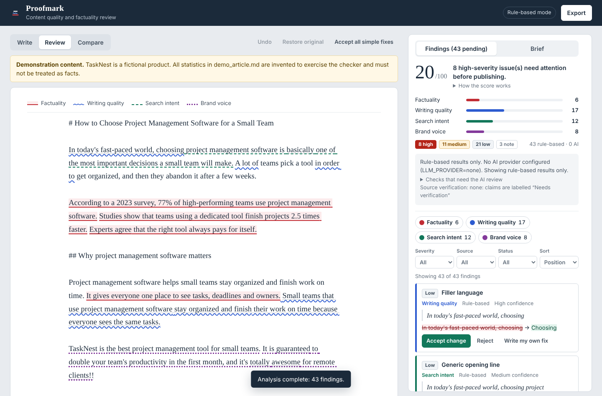

# Proofmark: Content Quality & Factuality Checker

Proofmark reviews articles, blog posts and web pages for **factuality risks, repetition, vague language, search-intent gaps, brand-voice drift and missing sections**. Every finding points to the exact text it refers to, explains why it was flagged, and offers a suggestion you can accept, reject, or rewrite yourself. The original text is never modified; accepted changes build a separate revised copy you can compare and export.

It runs fully without any paid API. Deterministic rules cover the core checks; an optional LLM adds semantic review and an optional search API adds candidate sources for flagged claims.



## Features

| Area | What it does |
|---|---|
| **Input** | Large manuscript editor, optional public-URL text extraction (robots.txt respected, SSRF-guarded), live word / character / paragraph counts, Analyze / Clear / Reset / Load demo, empty and size-limit validation. |
| **Factuality** | Flags sentences with statistics, dates, research/expert references, product specs, ranking claims and absolute statements. Each gets a severity, a rule-defined confidence, the reason, and the kind of source that would verify it. Status is **Needs verification** unless a source was actually retrieved. Claims are never marked false for lack of a source, and no citation is ever invented. |
| **Writing quality** | Repeated phrases, repeated words in a sentence, repeated ideas (lexical similarity), vague wording, filler, unsupported superlatives, guaranteed-results claims, long sentences, undefined acronyms, unclear references, placeholders, explanations that stop short, inconsistent terminology. |
| **Search intent** | Uses your keyword, secondary keywords, audience, intent, page type and objective to flag a missing topic, a weak introduction, expected sections that are absent, likely unanswered questions, FAQ opportunities, missing CTAs, and internal-link opportunities **only for URLs you supply**. These are editorial heuristics, not ranking factors. |
| **Brand voice** | Applies only rules you supply: preferred-term mappings, avoid lists, "Avoid:/Never use" lines from your guidelines, a chosen tone (formal, conversational, plain, confident), a no-unsupported-claims toggle, and a measured style comparison against your example content. |
| **Review dashboard** | Issue-density score with its formula shown, counts by category / severity / origin, filters (category, severity, rule vs AI, decision status), sorting, highlighted original text (each category has its own colour **and** underline style), and a side-by-side Original vs Revised view. |
| **Accept / reject** | Per-finding Accept, Reject, Write my own fix, Undo decision; global Undo, Restore original and Accept all simple fixes. Overlapping accepted edits are reported as conflicts instead of silently overwriting text. |
| **Exports** | Audit report (Markdown and PDF), findings CSV (with spreadsheet-formula protection), revised content (.md / .txt), and the original as analyzed. |

Rule-based and AI findings are labelled separately everywhere (cards, CSV, report).

## Quick start

Requirements: Python 3.11+ and Node 20+.

```bash
# 1. Backend (http://127.0.0.1:8000)
cd backend
python -m venv .venv && source .venv/bin/activate   # Windows: .venv\Scripts\activate
pip install -r requirements-dev.txt
cp ../.env.example .env                              # optional; defaults work with no keys
uvicorn app.main:app --reload --port 8000

# 2. Frontend (http://localhost:5173), in a second terminal
cd frontend
npm install
npm run dev
```

Open http://localhost:5173 and click **Load demo article**, then **Analyze**. The Vite dev server proxies `/api` to the backend.

### Single-service mode

`npm run build` in `frontend/` creates `frontend/dist`. When that folder exists, FastAPI serves the UI too, so `uvicorn app.main:app --port 8000` alone serves everything at http://127.0.0.1:8000.

## Enabling the optional AI review and source retrieval

Set these in `backend/.env` or your host's environment (see `.env.example`):

```bash
# Any OpenAI-compatible API (OpenAI, Groq, OpenRouter, Together, or local Ollama)
LLM_PROVIDER=openai
LLM_API_KEY=sk-...
LLM_MODEL=gpt-4o-mini
LLM_BASE_URL=                 # e.g. http://localhost:11434/v1 for Ollama (no key needed)

# or Anthropic
LLM_PROVIDER=anthropic
LLM_API_KEY=...
LLM_MODEL=claude-haiku-4-5

# Candidate sources for flagged claims (Brave Search API)
SEARCH_PROVIDER=brave
SEARCH_API_KEY=...
```

Without an LLM the app runs in **rule-based mode** and tells the user which checks need AI. If the provider fails (timeout, HTTP error, invalid JSON), the run still returns all rule-based findings and reports the error.

## Tests

```bash
cd backend && python -m pytest -v                 # 46 tests, all network mocked
cd frontend && npm test                           # 22 unit/component tests (integration suite skipped)
cd frontend && API_URL=http://127.0.0.1:8000 npm test   # + 3 live frontend-to-backend tests
python e2e/ui_smoke.py                            # optional browser smoke test (needs Playwright + both servers)
```

Latest executed results are in [TEST_RESULTS.md](TEST_RESULTS.md).

## Demonstration

`samples/demo_article.md` is **demonstration content** about a fictional product (TaskNest) with invented statistics, written to contain factual claims, repeated ideas, vague statements, superlatives, brand-voice violations and an unfinished ending. `samples/demo_brief.json` is the matching brief.

- In the app: **Load demo article → Analyze**.
- From the command line: `python scripts/run_demo.py` regenerates [samples/DEMO_RESULTS.md](samples/DEMO_RESULTS.md), the tool's actual output (43 findings in rule-based mode). No sources are attached; every claim is "Needs verification".

## Architecture

```
frontend/ (React 19 + TypeScript + Vite)            backend/ (FastAPI + Pydantic)
  App.tsx          state: text, brief, result,         app/main.py        /api/health, /api/analyze, /api/extract
                   decisions + undo history            app/engine.py      pipeline, score, summary, limitations
  components/      Editor, BriefPanel, FindingsPanel,  app/analyzers/
                   FindingCard, DocumentViews,           text_utils.py    offset-preserving segmentation
                   ExportMenu                            quality.py       writing-quality rules
  lib/suggestions  applyDecisions(): pure, never         factuality.py    claim detection (never verdicts)
                   mutates the original, reports         intent.py        brief-driven completeness checks
                   overlap conflicts                     brand.py         user-supplied brand rules only
  lib/text         stats, highlight segmentation       app/llm/
  lib/exports      CSV, Markdown, PDF (jsPDF)            providers.py     OpenAI-compatible + Anthropic over httpx
  api.ts           fetch wrapper                         semantic.py      AI review with evidence validation
                                                         verify.py        search-based candidate sources
                                                       app/extract.py     safe URL fetch + readable-text extraction
```

**Evidence contract.** Every span the backend returns satisfies `original[start:end] == evidence.text`. Rules compute spans from the original string; AI findings are kept only if their quote is found verbatim in the original (otherwise they are discarded and the count is reported). Tests assert this for every finding.

**Suggestions.** A finding's `suggestion.replacement` is either an exact string that replaces the evidence span or `null` (advisory: needs a source or a human rewrite). The frontend applies accepted replacements to a copy, in document order; an accepted edit that overlaps an earlier accepted edit is not applied and is shown as a conflict.

**Data integrity.**
- Reviewed text and extracted pages are untrusted data. The LLM prompt wraps the document in delimiters and instructs the model not to follow embedded instructions; any URL the model emits is stripped. Sources come only from the search API.
- Confidence for rule findings is a fixed property of each rule (how reliably the pattern indicates a real problem). AI confidence is labelled as model-reported.
- The score is a transparent issue-density index; its formula is shown in the UI and report.

No database is used: analysis is stateless and decisions live in the browser session, so no user content is stored server-side.

## Known limitations

- Rule-based checks are pattern matches and will produce some false positives and misses. "Repeated idea" detection is lexical (shared vocabulary); paraphrased repetition needs the AI review.
- Factuality detection finds *checkable* claims; it cannot tell whether they are true. With search configured, sources are candidates; with an LLM too, the judgement is based on search snippets, not full pages.
- Search-intent checks use English cue words and a fixed set of page-type expectations.
- URL extraction does not run JavaScript, so client-rendered pages may return no text (the user is told to paste the text instead).
- Decisions are not persisted across page reloads.
- The PDF export uses jsPDF's built-in font, so characters outside Windows-1252 are replaced with `?` in the PDF (the Markdown report keeps them).

## Security notes

- No secrets in code; keys come from environment variables (`.env` is git-ignored).
- URL extraction allows only http(s), rejects embedded credentials, resolves the host and blocks private, loopback, link-local and reserved addresses (re-checked on every redirect), honours robots.txt, and enforces timeout and size limits.
- Input size is capped (`MAX_CONTENT_CHARS`, default 100,000).
- CSV exports prefix cells beginning with `= + - @` to prevent formula injection.
- Source links open with `rel="noopener noreferrer nofollow"`.
- CORS is restricted to configured origins.

## Deployment

See [DEPLOYMENT.md](DEPLOYMENT.md) for GitHub setup and Docker / Render / split-hosting instructions. Development progress and handoff notes are in [PROGRESS.md](PROGRESS.md).
